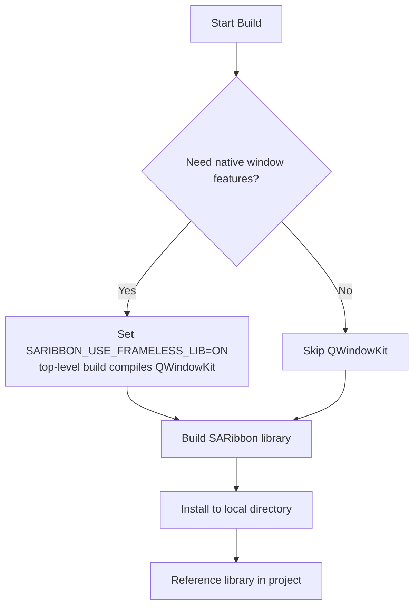
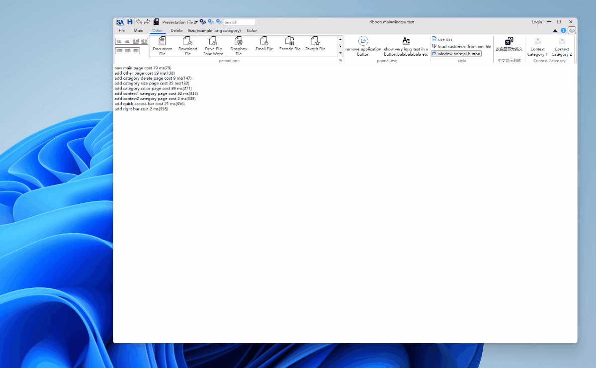

# SARibbon Build Instructions

- ✅ **Static approach**: add `SARibbon.h` + `SARibbon.cpp` directly — no build needed
- ✅ **Dynamic library build**: CMake-based, with compiler/version-isolated install
- ✅ **Optional QWindowKit**: native OS window features (snap layout, multi-monitor)

!!! tip
    You don't need to compile SARibbon — just add `SARibbon.h` and `SARibbon.cpp` (located in the `src` directory) to your project.

This document explains in detail how to build SARibbon dynamically.  
If you are not familiar with building, we recommend the static approach: simply add `SARibbon.h` and `SARibbon.cpp` to your project and you are ready to go.

## Sub-document Navigation

| Document | Content |
|----------|---------|
| [Building SARibbon Library](./build-SARibbon.md) | CMake build options and detailed steps |
| [Third-Party Library Build](./build-3rdparty.md) | Optional: build, upgrade or debug QWindowKit separately |
| [Common Build Errors](./common-build-errors.md) | Troubleshooting compilation issues |
| [Internationalization](./i18n.md) | Translation file generation and new languages |

## Build Workflow Overview

SARibbon builds from a single project: with `SARIBBON_USE_FRAMELESS_LIB` enabled, the top-level CMake automatically builds the bundled QWindowKit, so there is no separate third-party build step.



!!! warning "Note"
    SARibbon removed qmake-based builds after v2.6.3 and only supports CMake. If you need qmake support, use v2.6.2 or earlier.

## QWindowKit Third-Party Library

SARibbon uses [QWindowKit](https://github.com/stdware/qwindowkit) as its borderless-window solution, while also supporting a simple built-in borderless mode. If you need native OS window features, such as Windows 7+ snap-to-edge handling or Windows 11 Snap Layout effects, it is recommended to enable the [QWindowKit](https://github.com/stdware/qwindowkit) library. This library also effectively addresses multi-monitor movement issues.

After enabling QWindowKit, you will be able to achieve effects like:



To enable [QWindowKit](https://github.com/stdware/qwindowkit), just turn on `SARIBBON_USE_FRAMELESS_LIB` in the top-level CMake:

```shell
cmake -S . -B build -DSARIBBON_USE_FRAMELESS_LIB=ON
```

QWindowKit is resolved in this order:

1. A package specified by `-DQWindowKit_DIR`, or provided by vcpkg;
2. The bundled source at `src/SARibbonBar/3rdparty/qwindowkit`, built directly as a subdirectory (recommended, no extra steps);
3. A package previously installed under `bin_qt.../lib/cmake/QWindowKit`;
4. The system installation path.

Building from source requires CMake 3.19 or newer. The first configure also builds QWindowKit's qmsetup helper, so it takes a little longer; later configures reuse the cache.

!!! note
    If the repository was cloned without `--recursive` (or nested submodules are incomplete), CMake runs `git submodule update --init --recursive` automatically at configure time (disable with `-DSARIBBON_QWK_AUTO_INIT_SUBMODULE=OFF`). Users who downloaded a source ZIP have no git metadata and must either place the QWindowKit source at `src/SARibbonBar/3rdparty/qwindowkit` manually or point `-DQWindowKit_DIR` at a prebuilt package.

To build, upgrade or debug QWindowKit separately, see [Third-Party Library Build](./build-3rdparty.md).

## Building the SARibbon Library

SARibbon only supports the CMake build approach (qmake support was removed after v2.6.3). For detailed build steps and configuration options, see [Building SARibbon Library](./build-SARibbon.md).

If you encounter issues during the build process, see [Common Build Errors](./common-build-errors.md).

## Installation Location

After CMake finishes building, the `install` target will deploy all dependencies.  
Consumers can simply call `find_package` to pull in libraries, dependencies and predefined macros—this is the recommended workflow.

During development, however, you often need to switch between compilers (MSVC, MinGW, …) and Qt versions.  
Using the default global location (e.g. `C:\Program Files` on Windows) allows only one variant to be installed at a time.

To keep builds isolated, SARibbon defaults to **local installation**.  
A folder is created whose name encodes the Qt version and compiler, e.g.  
`bin_qt{version}_[MSVC|GNU]_x[64|86]`.

You can control this behaviour with the CMake option  
`SARIBBON_INSTALL_IN_CURRENT_DIR` (default `ON`).  
When `ON`, the above local folder is used; when `OFF`, the standard system location is used.