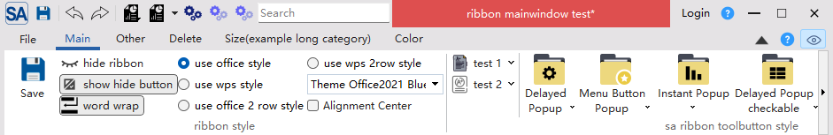

# Title Bar Settings

The SARibbon title bar is the area at the very top of the Ribbon interface, used to display the application's window title (`windowTitle`). SARibbon allows you to fully customize the title bar's height, background color, text color, alignment, as well as the title icon and functional buttons.

**Key Features**

- ✅ **Custom title height**: precisely control title bar height via `setTitleBarHeight()`
- ✅ **Title color customization**: support setting title text color and background color (QBrush)
- ✅ **Title alignment**: support left-aligned and center-aligned, simulating WPS style
- ✅ **Title icon support**: display window icon and right-click menu via `SARibbonTitleIconWidget`, with options to disable clicks or customize the click behavior
- ✅ **Show/hide toggle**: support dynamically hiding or showing the title bar
- ✅ **Word wrap control**: control whether title text automatically wraps via `enableWordWrap`

## Core API

`SARibbonBar` provides the following title bar-related properties and methods:

| Method | Parameters | Return Value | Description |
|------|------|--------|------|
| `setWindowTitleTextColor()` | `const QColor&` | `void` | Set title bar text color |
| `windowTitleTextColor()` | None | `QColor` | Get current title text color |
| `setWindowTitleAligment()` | `Qt::Alignment` | `void` | Set title text alignment |
| `windowTitleAligment()` | None | `Qt::Alignment` | Get title text alignment |
| `setWindowTitleBackgroundBrush()` | `const QBrush&` | `void` | Set title bar background brush |
| `windowTitleBackgroundBrush()` | None | `QBrush` | Get title bar background brush |
| `setTitleVisible()` | `bool` | `void` | Set title bar visibility |
| `isTitleVisible()` | None | `bool` | Query whether the title bar is visible |
| `setTitleBarHeight()` | `int, bool` | `void` | Set title bar height |
| `titleBarHeight()` | None | `int` | Get title bar height |
| `setTabBarBaseLineColor()` | `const QColor&` | `void` | Set tab bar baseline color |
| `tabBarBaseLineColor()` | None | `QColor` | Get tab bar baseline color |
| `setEnableWordWrap()` | `bool` | `void` | Enable/disable title word wrap |
| `isEnableWordWrap()` | None | `bool` | Query whether word wrap is enabled |
| `setEnableShowPanelTitle()` | `bool` | `void` | Enable/disable panel title display |
| `isEnableShowPanelTitle()` | None | `bool` | Query whether panel titles are displayed |
| `setTabOnTitle()` | `bool` | `void` | Set tabs to overlay the title bar |
| `isTabOnTitle()` | None | `bool` | Query whether tabs overlay the title |
| `setTitleIconVisible()` | `bool` | `void` | Set title icon visibility |
| `isTitleIconVisible()` | None | `bool` | Query whether the title icon is visible |
| `titleIconWidget()` | None | `SARibbonTitleIconWidget*` | Get title icon widget pointer |

After obtaining the `SARibbonTitleIconWidget` via `titleIconWidget()`, you can also control the icon's click behavior:

| Method | Parameters | Return Value | Description |
|------|------|--------|------|
| `setClickEnabled()` | `bool` | `void` | Enable/disable icon clicks (enabled by default); when disabled, left and right clicks are ignored |
| `isClickEnabled()` | None | `bool` | Query whether click handling is enabled |
| `setMenuEnabled()` | `bool` | `void` | Enable/disable the built-in window control menu (enabled by default) |
| `isMenuEnabled()` | None | `bool` | Query whether the built-in menu is enabled |
| `titleIconClicked()` | Signal | `int, const QPoint&` | Emitted when the icon is clicked while the built-in menu is disabled; parameters are the mouse button (`Qt::MouseButton`) and the global position |

## Common Scenarios

| Scenario | Recommended Method | Description |
|------|---------|------|
| Unregistered / trial prompt | `setWindowTitleBackgroundBrush()` + `setWindowTitleTextColor()` | Red background + white text, prominently indicating software status to the user |
| Read-only mode | Gray background + dark text | Indicates the current document cannot be edited |
| Hide title bar | `setTitleVisible(false)` | Suitable for compact mode, native frame mode |
| Custom alignment | `setWindowTitleAligment(Qt::AlignLeft)` | Title left-aligned, similar to WPS style |
| Title icon display | `setTitleIconVisible(true)` | Display window icon, supports left-click and right-click menu |
| Disable icon clicks | `titleIconWidget()->setClickEnabled(false)` | The icon stays visible, but left/right clicks are ignored |
| Customize icon clicks | `titleIconWidget()->setMenuEnabled(false)` + connect `titleIconClicked` | Take over the click behavior, for example showing a custom menu |

## Setting Title Bar Color and Style

You can achieve special title bar display effects with the following code:

```cpp
void MainWindow::setWindowTitleColor()
{
    SARibbonBar* ribbon = ribbonBar();
    if (!ribbon) {
        return;
    }
    // Set title background to red
    ribbon->setWindowTitleBackgroundBrush(QColor(222, 79, 79));
    // Set title text color to white
    ribbon->setWindowTitleTextColor(Qt::white);
    // Update display
    ribbon->update();
}
```

The display effect of the above code is as follows:



## Using QSS Style Sheets to Set the Title Bar

In addition to code-based settings, you can also customize title bar styles through Qt Style Sheets (QSS):

```css
/* Set title bar background color and text color */
SARibbonBar {
    background-color: #4A90E2;        /* Blue background */
    color: #FFFFFF;                   /* White text */
    font-family: "Microsoft YaHei";  /* Font */
    font-size: 13px;
    font-weight: bold;               /* Bold */
}

/* Hover highlight effect */
SARibbonBar:hover {
    background-color: #5BA0F2;
}
```

!!! tip "QSS Live Preview"
    After modifying QSS, you need to call `ribbon->update()` to see the effect immediately. You can use a QSS debugging tool during development to preview styles in real time.

## Resetting the Title Bar

In some scenarios, you need to restore the title bar to its default state after dynamically changing its color:

```cpp
void MainWindow::resetTitleBar()
{
    SARibbonBar* ribbon = ribbonBar();
    if (!ribbon) {
        return;
    }
    // Restore to transparent background (use theme default color)
    ribbon->setWindowTitleBackgroundBrush(Qt::NoBrush);
    // Restore to default text color (follow theme)
    ribbon->setWindowTitleTextColor(QColor());
    ribbon->update();
}
```

!!! info "Default Values"
    Calling `setWindowTitleTextColor(QColor())` or `setWindowTitleBackgroundBrush(Qt::NoBrush)` restores to theme defaults. `QColor()` constructs an invalid color object, indicating the system default color should be used.

## Complete Code Example

The following example demonstrates initializing the title bar completely in the `MainWindow` constructor:

```cpp
MainWindow::MainWindow(QWidget* parent)
    : SARibbonMainWindow(parent)
{
    // Create SARibbonBar
    SARibbonBar* ribbon = new SARibbonBar(this);
    setMenuBar(ribbon);

    // Set title bar height
    ribbon->setTitleBarHeight(40, true);

    // Set title text color and alignment
    ribbon->setWindowTitleTextColor(QColor(33, 33, 33));
    ribbon->setWindowTitleAligment(Qt::AlignCenter);

    // Enable title icon
    ribbon->setTitleIconVisible(true);

    // Enable tabs overlaying title bar (compact style)
    ribbon->setTabOnTitle(true);

    // Set panel title display
    ribbon->setEnableShowPanelTitle(true);

    // Create Ribbon categories and panels
    SARibbonCategory* category = ribbon->addCategoryPage(tr("Home"));
    category->addPanel(tr("File"));

    setCentralWidget(new QWidget(this));
}
```

!!! tip "Note"
    Title bar settings are only visible in Loose mode. In Compact mode, the title bar and tab bar are merged, so title bar background color settings will not have a noticeable effect, but text color still takes effect.
## Title Bar Icon System Menu

In frameless mode (`UseRibbonFrame`), clicking (or right-clicking) the application icon at the top-left of the title bar opens the system menu: Restore / Move / Size / Minimize / Maximize / Close.

- **Move (M)**: enters the system-level keyboard move mode — use arrow keys to move the window, Enter to confirm, Esc to cancel (same as the native Windows system menu);
- **Size (S)**: enters the system-level keyboard resize mode — use arrow keys to resize the window, Enter to confirm, Esc to cancel;
- if the window is maximized/fullscreen, Move/Size first restores it to normal state;
- these two items are available on Windows; on other platforms they are explicitly disabled in the menu (no dead menu entries).

!!! note
    This menu is only available in frameless mode (`UseRibbonFrame`) — in native frame mode (`UseNativeFrame`) the system menu is provided by the OS and the title icon is hidden.

### Disabling or Customizing Icon Clicks

If you do not want clicking the icon to open the built-in menu, disable click handling entirely:

```cpp
SARibbonTitleIconWidget* iconWidget = ribbonBar()->titleIconWidget();
if (iconWidget) {
    // No menu, no further handling
    iconWidget->setClickEnabled(false);
}
```

To take over the click behavior (for example, show your own menu), disable the built-in menu and connect to `titleIconClicked`:

```cpp
SARibbonTitleIconWidget* iconWidget = ribbonBar()->titleIconWidget();
if (iconWidget) {
    iconWidget->setMenuEnabled(false);
    connect(iconWidget, &SARibbonTitleIconWidget::titleIconClicked, this,
            [](int button, const QPoint& globalPos) {
                QMenu menu;
                menu.addAction(tr("About"));
                menu.exec(globalPos);
            });
}
```

The `button` parameter is a `Qt::MouseButton` value: left clicks come from the mouse press event and right clicks from the context menu event. Call `setMenuEnabled(true)` to restore the default behavior.

## Main Window Frame Border

In frameless mode (`UseRibbonFrame`) the window boundary may be indistinguishable from a same-colored background (e.g., a white document area or desktop). An optional 1px frame border can be enabled:

```cpp
setFrameBorderEnabled(true);          // enable (default off, no impact on existing appearance)
setFrameBorderColor(QColor(Qt::red)); // optional: custom color; pass an invalid QColor() to follow the theme
```

- **Default off**: without setting anything, the window looks exactly like previous versions;
- **Color resolution order**: custom `frameBorderColor` (if valid) → the current theme palette's `border-color` token → a fallback of the palette window color darkened;
- **Theme synchronization**: when following the theme, switching themes triggers a repaint automatically;
- **Visible range**: the left/right edges and the bottom edge are fully visible (drawn inside the main window's reserved content margins); the top edge is covered by the title bar (the ribbon), whose own boundary serves as the visual edge;
- **QWK path difference**: with QWindowKit enabled (`SARIBBON_USE_FRAMELESS_LIB=ON`) the window is handled by QWK's native frame mechanism and the self-drawn border may be covered by the system frame; prefer QWK's border capability on that path.

Run the "window frame border" toggle in the **style** panel of the **other** tab in `example/MainWindowExample` to verify in real time.

## Dragging the Title Bar to Screen Edges (Half-Screen / Maximize)

In frameless mode (`UseRibbonFrame`), dragging the ribbon title bar triggers the system snap (Aero Snap) behavior:

- drag to the **left/right** screen edge → half-screen preview appears, release to dock to that half;
- drag to the **top** → maximize preview appears, release to maximize;
- drag **away** from a docked state → restores to a normal window;
- dragging the title bar of a maximized window restores it first, then moves (same as Office / browsers).

Interactive widgets on the title bar — system buttons, the quick access bar, context tabs, the application button, the title icon — are unaffected and keep responding to clicks.

### Differences Between the Two Frame Modes

| Mode | Snap behavior |
|-------|---------------|
| `UseRibbonFrame` (default frameless) | SARibbon delegates the title bar drag to the native system message (Windows); the system provides the snap/half-screen/maximize previews. Non-Windows platforms keep the pure-Qt drag behavior (no snapping) |
| `UseNativeFrame` (native frame) | the system native frame provides the full Snap behavior out of the box |

### Win11 Snap Layout Flyout

The Windows 11 Snap Layout flyout (the layout picker shown when hovering the maximize button) requires the QWindowKit path (`SARIBBON_USE_FRAMELESS_LIB=ON` plus `SARIBBON_ENABLE_SNAPLAYOUT`); the default path only provides drag snapping, not the hover flyout.

## Window Shadow

Frameless mode (`UseRibbonFrame`) has no shadow by default. The DWM system shadow can be enabled:

```cpp
setFrameShadowEnabled(true);  // effective on Windows (non-QWK path)
```

### Platform Differences

| Platform / path | Shadow behavior |
|-----------------|-----------------|
| Windows (default path) | enabling turns on the DWM system shadow (implementation: adds `WS_THICKFRAME` + `DwmExtendFrameIntoClientArea`, with matching `WM_NCCALCSIZE`/`WM_NCACTIVATE` handling; the client area still covers the whole window) |
| Windows (QWindowKit path) | QWK provides its own shadow handling; `setFrameShadowEnabled` is a no-op |
| macOS | the system provides shadows natively, nothing to set |
| Linux | no universal solution (depends on the window manager) |

### Notes

- **The system does not draw the shadow when the window is maximized** — this is Windows behavior, not a bug;
- After enabling, the system resize cursors (at the window edges) are also provided by the system, coexisting with the original pure-Qt resizing;
- Run the "window frame shadow" toggle in the **style** panel of the **other** tab in `example/MainWindowExample` to verify in real time.
