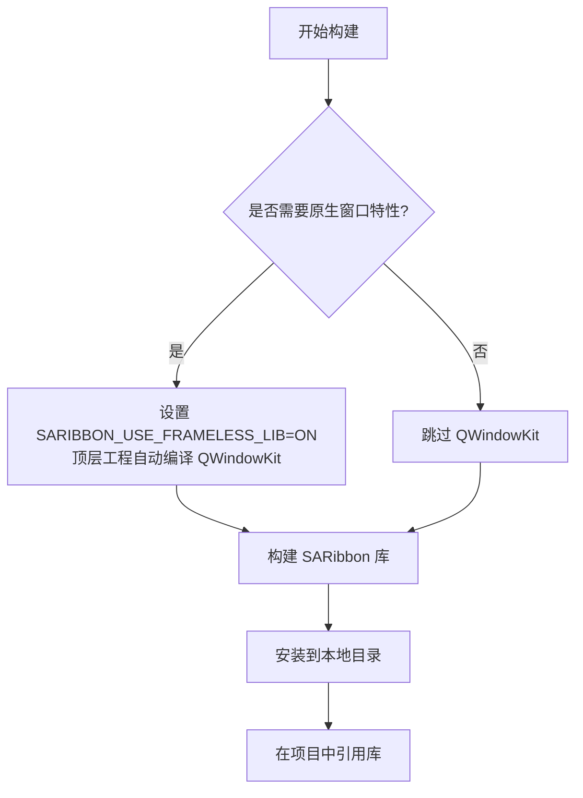

# SARibbon构建说明

!!! tip "提示"
    你不需要编译SARibbon，只需把`SARibbon.h`和`SARibbon.cpp`（这两个文件位于src目录下）引入你的工程即可

此文详细介绍如何构建SARibbon为**动态库**。如果你不熟悉C++的构建流程，只需把 `SARibbon.h` 和 `SARibbon.cpp` 引入你的工程即可使用。

## 子文档导航

| 文档 | 内容 |
|------|------|
| [SARibbon库构建](./build-SARibbon.md) | CMake构建选项和详细步骤 |
| [第三方库编译](./build-3rdparty.md) | 可选：单独编译、升级或调试 QWindowKit |
| [构建常见错误](./common-build-errors.md) | 编译问题排查与解决 |
| [多语言翻译](./i18n.md) | 翻译文件生成与新增语言 |

## 构建流程总览

SARibbon 只需要构建一个工程：开启 `SARIBBON_USE_FRAMELESS_LIB` 后，顶层 CMake 会自动编译仓库内的 QWindowKit，不再需要先单独构建第三方库。



!!! warning "注意"
    SARibbon在v2.6.3版本后移除了qmake构建方式，仅支持cmake构建方式，如果你需要使用qmake构建方式，请使用v2.6.2及以下版本。

## QWindowKit 第三方库

SARibbon 采用 [QWindowKit](https://github.com/stdware/qwindowkit) 作为无边框窗口方案，同时也支持简单的无边框设置。如果你需要操作系统原生的窗口特性，如 Windows 7 及以后版本的贴边处理，或 Windows 11 的 Snap Layout 效果，建议启用 [QWindowKit](https://github.com/stdware/qwindowkit) 库。该库还能有效解决多屏幕移动问题。

启用 QWindowKit 后，你将能实现如下效果：


若要启用 [QWindowKit](https://github.com/stdware/qwindowkit)，只需在顶层 CMake 中打开 `SARIBBON_USE_FRAMELESS_LIB`：

```shell
cmake -S . -B build -DSARIBBON_USE_FRAMELESS_LIB=ON
```

配置时会按以下顺序查找 QWindowKit：

1. 用户通过 `-DQWindowKit_DIR` 指定的安装包，或 vcpkg 提供的包；
2. 仓库内的源码 `src/SARibbonBar/3rdparty/qwindowkit`，直接作为子目录编译（推荐，无需额外步骤）；
3. 之前安装到 `bin_qt.../lib/cmake/QWindowKit` 的包；
4. 系统安装路径。

用源码构建要求 CMake 3.19 及以上。首次配置会自动编译 QWindowKit 依赖的 qmsetup，耗时略长，之后会使用缓存。

!!! note "说明"
    如果克隆时没有使用 `--recursive`（或嵌套依赖不完整），CMake 会在配置时自动执行 `git submodule update --init --recursive`（可用 `-DSARIBBON_QWK_AUTO_INIT_SUBMODULE=OFF` 关闭）。下载源码 ZIP 的用户没有 git 仓库，需要手动把 QWindowKit 源码放到 `src/SARibbonBar/3rdparty/qwindowkit`，或通过 `-DQWindowKit_DIR` 指定已安装的包。

如果需要单独编译、升级或调试 QWindowKit，仍可参考 [第三方库构建](./build-3rdparty.md)。

## 构建 SARibbon 库

SARibbon 仅支持 CMake 构建方式（v2.6.3后移除了QMake支持），详细的构建步骤和配置选项请参阅 [SARibbon库构建](./build-SARibbon.md)。

如果在构建过程中遇到问题，请参阅 [构建常见错误](./common-build-errors.md)。

## 关于安装位置

通过 CMake 构建完成后，使用 `install` 命令可以安装所有依赖。引用库时，只需通过 `find_package` 命令，即可将所有依赖和预定义宏等配置一并引入，这是目前最推荐的做法。

然而，在程序开发过程中，可能会遇到不同编译器（如MSVC、MinGW）和不同Qt版本的编译问题。如果使用默认的安装位置（Windows下为C:\Program Files），则只能安装一个版本的库。

为了区分不同编译器和Qt版本，`SARibbon` 默认使用本地安装。本地安装会根据编译器和Qt版本生成一个安装文件夹，文件夹命名格式为 `bin_qt{version}_[MSVC/GNU]_x[64/86]`。

通过 CMake 的 `SARIBBON_INSTALL_IN_CURRENT_DIR` 选项可以配置是否根据编译器和Qt版本安装到本地，该选项默认为 `ON`，即会根据编译器和Qt版本生成一个本地文件夹进行安装。
