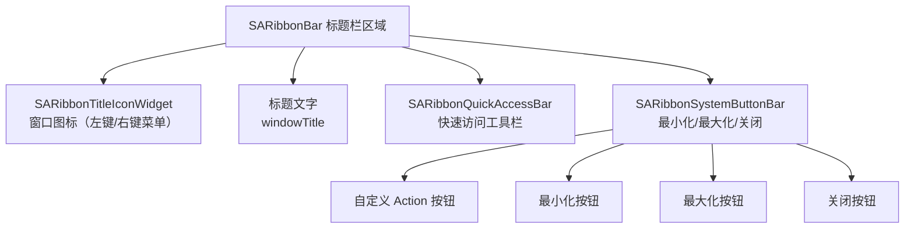
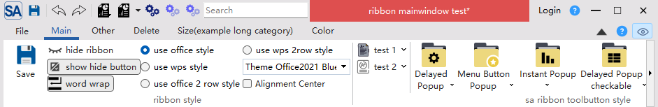

# 标题栏设置

- **自定义标题高度**: 通过 `setTitleBarHeight()` 精确控制标题栏高度
- **标题颜色定制**: 支持设置标题文字颜色和背景色（QBrush），可用于未注册/只读等状态提示
- **标题对齐方式**: 支持左对齐、居中对齐，可模拟 WPS 风格
- **标题图标支持**: 通过 `SARibbonTitleIconWidget` 显示窗口图标，支持左键点击和右键菜单，并可禁用点击或自定义点击行为
- **显示/隐藏切换**: 支持动态隐藏或显示标题栏，适配紧凑模式

SARibbon 的标题栏（Title Bar）是位于 Ribbon 界面最顶部的区域，用于显示应用程序的窗口标题（windowTitle）。SARibbon 允许您完整定制标题栏的高度、背景颜色、文字颜色、对齐方式，以及标题图标和功能按钮。

## 标题栏组件结构

标题栏由多个子组件协同构成，它们的关系如下：



## 核心 API

`SARibbonBar` 提供以下标题栏相关属性与方法：

| 方法 | 参数 | 返回值 | 说明 |
|------|------|--------|------|
| `setWindowTitleTextColor()` | `const QColor&` | `void` | 设置标题栏文字颜色 |
| `windowTitleTextColor()` | 无 | `QColor` | 获取当前标题文字颜色 |
| `setWindowTitleAligment()` | `Qt::Alignment` | `void` | 设置标题文字对齐方式 |
| `windowTitleAligment()` | 无 | `Qt::Alignment` | 获取标题文字对齐方式 |
| `setWindowTitleBackgroundBrush()` | `const QBrush&` | `void` | 设置标题栏背景画刷 |
| `windowTitleBackgroundBrush()` | 无 | `QBrush` | 获取标题栏背景画刷 |
| `setTitleVisible()` | `bool` | `void` | 设置标题栏显隐状态 |
| `isTitleVisible()` | 无 | `bool` | 查询标题栏是否可见 |
| `setTitleBarHeight()` | `int, bool` | `void` | 设置标题栏高度 |
| `titleBarHeight()` | 无 | `int` | 获取标题栏高度 |
| `setTabBarBaseLineColor()` | `const QColor&` | `void` | 设置 Tab 栏底线颜色 |
| `tabBarBaseLineColor()` | 无 | `QColor` | 获取 Tab 栏底线颜色 |
| `setEnableWordWrap()` | `bool` | `void` | 启用/禁用标题词换行 |
| `isEnableWordWrap()` | 无 | `bool` | 查询词换行是否启用 |
| `setEnableShowPanelTitle()` | `bool` | `void` | 启用/禁用 Panel 标题显示 |
| `isEnableShowPanelTitle()` | 无 | `bool` | 查询 Panel 标题是否显示 |
| `setTabOnTitle()` | `bool` | `void` | 设置 Tab 覆盖标题栏 |
| `isTabOnTitle()` | 无 | `bool` | 查询 Tab 是否覆盖标题 |
| `setTitleIconVisible()` | `bool` | `void` | 设置标题图标显隐 |
| `isTitleIconVisible()` | 无 | `bool` | 查询标题图标是否可见 |
| `titleIconWidget()` | 无 | `SARibbonTitleIconWidget*` | 获取标题图标控件指针 |

通过 `titleIconWidget()` 取得 `SARibbonTitleIconWidget` 后，还可以控制图标的点击行为：

| 方法 | 参数 | 返回值 | 说明 |
|------|------|--------|------|
| `setClickEnabled()` | `bool` | `void` | 启用/禁用图标点击（默认为启用）；禁用后左键和右键都不响应 |
| `isClickEnabled()` | 无 | `bool` | 查询点击是否启用 |
| `setMenuEnabled()` | `bool` | `void` | 启用/禁用内置窗口控制菜单（默认为启用） |
| `isMenuEnabled()` | 无 | `bool` | 查询内置菜单是否启用 |
| `titleIconClicked()` | 信号 | `int, const QPoint&` | 内置菜单禁用时，点击图标会发射该信号，参数为鼠标按键（`Qt::MouseButton`）和全局坐标 |

## 常见场景

| 场景 | 推荐方法 | 说明 |
|------|---------|------|
| 未注册/试用提示 | `setWindowTitleBackgroundBrush()` + `setWindowTitleTextColor()` | 红色背景 + 白色文字，醒目提示用户软件状态 |
| 只读模式 | 灰色背景 + 深色文字 | 表示当前文档不可编辑 |
| 隐藏标题栏 | `setTitleVisible(false)` | 适用于紧凑模式、原生边框模式 |
| 自定义对齐 | `setWindowTitleAligment(Qt::AlignLeft)` | 标题左对齐，类似 WPS 风格 |
| 标题图标显示 | `setTitleIconVisible(true)` | 显示窗口图标，支持左键点击和右键菜单 |
| 禁用图标点击 | `titleIconWidget()->setClickEnabled(false)` | 图标仍显示，但点击和右键都不响应 |
| 自定义图标点击 | `titleIconWidget()->setMenuEnabled(false)` + 连接 `titleIconClicked` | 接管点击行为，例如弹出自己的菜单 |

## 设置标题栏颜色和样式

您可以通过以下代码实现特殊的标题栏显示：

```cpp
void MainWindow::setWindowTitleColor()
{
    SARibbonBar* ribbon = ribbonBar();
    if (!ribbon) {
        return;
    }
    // 设置标题背景为红色
    ribbon->setWindowTitleBackgroundBrush(QColor(222, 79, 79));
    // 设置标题文字颜色为白色
    ribbon->setWindowTitleTextColor(Qt::white);
    // 更新显示
    ribbon->update();
}
```

上面代码的显示效果如下：



## 使用 QSS 样式表设置标题栏

除代码设置外，还可以通过 Qt Style Sheets (QSS) 定制标题栏样式：

```css
/* 设置标题栏背景色和文字颜色 */
SARibbonBar {
    background-color: #4A90E2;        /* 蓝色背景 */
    color: #FFFFFF;                   /* 白色文字 */
    font-family: "Microsoft YaHei";  /* 字体 */
    font-size: 13px;
    font-weight: bold;               /* 粗体 */
}

/* 鼠标悬停时的高亮效果 */
SARibbonBar:hover {
    background-color: #5BA0F2;
}
```

!!! tip "QSS 实时预览"
    修改 QSS 后需要调用 `ribbon->update()` 才能立即看到效果。可在开发阶段使用 QSS 调试工具实时预览样式。

## 重置标题栏

在某些场景中，您需要在动态改变标题栏颜色后恢复为默认状态：

```cpp
void MainWindow::resetTitleBar()
{
    SARibbonBar* ribbon = ribbonBar();
    if (!ribbon) {
        return;
    }
    // 恢复为透明背景（使用主题默认色）
    ribbon->setWindowTitleBackgroundBrush(Qt::NoBrush);
    // 恢复为默认文字颜色（跟随主题）
    ribbon->setWindowTitleTextColor(QColor());
    ribbon->update();
}
```

!!! info "默认值说明"
    调用 `setWindowTitleTextColor(QColor())` 或 `setWindowTitleBackgroundBrush(Qt::NoBrush)` 可恢复为主题默认值。QColor() 构造无效颜色对象，表示使用系统默认色。

## 完整代码示例

以下示例演示在 `MainWindow` 构造函数中完整初始化标题栏：

```cpp
MainWindow::MainWindow(QWidget* parent)
    : SARibbonMainWindow(parent)
{
    // 创建 SARibbonBar
    SARibbonBar* ribbon = new SARibbonBar(this);
    setMenuBar(ribbon);

    // 设置标题栏高度
    ribbon->setTitleBarHeight(40, true);

    // 设置标题文字颜色和对齐方式
    ribbon->setWindowTitleTextColor(QColor(33, 33, 33));
    ribbon->setWindowTitleAligment(Qt::AlignCenter);

    // 启用标题图标
    ribbon->setTitleIconVisible(true);

    // 启用 Tab 覆盖标题栏（紧凑风格）
    ribbon->setTabOnTitle(true);

    // 设置 Panel 标题显示
    ribbon->setEnableShowPanelTitle(true);

    // 创建 Ribbon 分类和面板
    SARibbonCategory* category = ribbon->addCategoryPage(tr("主页"));
    category->addPanel(tr("文件"));

    setCentralWidget(new QWidget(this));
}
```

!!! tip "提示"
    标题栏设置仅在宽松模式（Loose）下可见。在紧凑模式下，标题栏和 Tab 栏合并，标题栏背景色设置不会有明显效果，但文字颜色仍然生效。

## 标题栏图标系统菜单

无边框模式（`UseRibbonFrame`）下，标题栏左上角的程序图标点击或右键会弹出系统菜单：还原 / 移动 / 大小 / 最小化 / 最大化 / 关闭。

- **移动（M）**：进入系统级键盘移动模式——点击后用方向键移动窗口，回车确认、Esc 取消（与 Windows 原生系统菜单一致）；
- **大小（S）**：进入系统级键盘缩放模式——用方向键调整窗口尺寸，回车确认、Esc 取消；
- 窗口处于最大化/全屏状态时点击移动或大小，会先还原为普通窗口再进入对应模式；
- 以上两项在 Windows 上可用；其他平台菜单中明确置灰（不提供点了没反应的菜单项）。

!!! note
    该菜单仅在无边框模式（`UseRibbonFrame`）下可用——原生边框模式（`UseNativeFrame`）使用系统自带菜单，标题图标被隐藏。

### 禁用或自定义图标点击

如果不希望点击图标弹出内置菜单，可以关闭内置菜单，改为由应用自己处理：

```cpp
SARibbonTitleIconWidget* iconWidget = ribbonBar()->titleIconWidget();
if (iconWidget) {
    // 只禁用点击，不弹菜单也不做任何处理
    iconWidget->setClickEnabled(false);
}
```

需要自定义点击行为（例如弹出自己的菜单）时，关闭内置菜单并连接 `titleIconClicked` 信号：

```cpp
SARibbonTitleIconWidget* iconWidget = ribbonBar()->titleIconWidget();
if (iconWidget) {
    iconWidget->setMenuEnabled(false);
    connect(iconWidget, &SARibbonTitleIconWidget::titleIconClicked, this,
            [](int button, const QPoint& globalPos) {
                QMenu menu;
                menu.addAction(tr("关于"));
                menu.exec(globalPos);
            });
}
```

`titleIconClicked` 的 `button` 参数是 `Qt::MouseButton` 的值，左键点击来自鼠标按下事件，右键点击来自上下文菜单事件。若只想恢复默认行为，调用 `setMenuEnabled(true)` 即可。

## 主窗口边框绘制

无边框模式（`UseRibbonFrame`）下窗口与同色背景（例如同为白色的文档区或桌面）可能无法分辨边界。可开启可选的 1px 边框绘制：

```cpp
setFrameBorderEnabled(true);          // 开启（默认关闭，不影响既有外观）
setFrameBorderColor(QColor(Qt::red)); // 可选：自定义颜色；传入无效 QColor() 则跟随主题
```

- **默认关闭**：不设置时窗口外观与旧版本完全一致；
- **颜色取值顺序**：自定义 `frameBorderColor`（有效色）→ 当前主题调色板的 `border-color` 色板 → palette 窗口色加深的兜底；
- **主题联动**：边框色跟随主题时，切换主题会自动重绘；
- **可见范围**：左右边与底边完整可见（落在主窗口预留的内容边距区）；顶边由标题栏（ribbon）覆盖，视觉上由 ribbon 自身的边界呈现；
- **QWK 路径差异**：启用 QWindowKit（`SARIBBON_USE_FRAMELESS_LIB=ON`）时窗口由 QWK 的原生 frame 机制处理，自绘边框可能被系统 frame 覆盖，建议该路径下依赖 QWK 的边框能力。

运行 `example/MainWindowExample` 的 **other** 标签页 **style** 面板 "window frame border" 开关可实时验证。

## 拖动标题栏贴边半屏 / 最大化

无边框模式（`UseRibbonFrame`）下，拖动 ribbon 标题栏触发系统的贴边（Aero Snap）行为：

- 拖到屏幕**左/右边缘** → 出现半屏预览，松手落地为左/右半屏；
- 拖到屏幕**顶部** → 出现最大化预览，松手最大化；
- 从贴边状态**拖离** → 还原为普通窗口；
- 最大化状态下拖动标题栏会先还原再移动（与 Office / 浏览器一致）。

标题栏上的系统按钮、快速访问工具栏、上下文页签、应用按钮、标题图标**不受影响**，仍然正常响应点击。

### 两种边框模式的差异

| 模式 | 贴边行为 |
|------|---------|
| `UseRibbonFrame`（默认无边框） | 由 SARibbon 把标题栏拖拽委托给系统原生消息（Windows），系统提供贴边/半屏/最大化预览；非 Windows 平台保持纯 Qt 拖拽行为（无贴边） |
| `UseNativeFrame`（原生边框） | 系统原生边框自带完整 Snap 行为，无需配置 |

### Win11 Snap Layout 弹出

Windows 11 的 Snap Layout 弹出层（鼠标悬停最大化按钮出现的分屏布局选择）需要 QWindowKit 路径（`SARIBBON_USE_FRAMELESS_LIB=ON` 并启用 `SARIBBON_ENABLE_SNAPLAYOUT`）；默认路径只提供拖拽贴边，不提供悬停弹出层。

## 窗口阴影

无边框模式（`UseRibbonFrame`）默认没有阴影。可通过属性开启 DWM 系统阴影：

```cpp
setFrameShadowEnabled(true);  // Windows（非 QWK 路径）下生效
```

### 平台差异

| 平台/路径 | 阴影行为 |
|-----------|---------|
| Windows（默认路径） | 开启后获得 DWM 系统阴影（实现：加 `WS_THICKFRAME` + `DwmExtendFrameIntoClientArea`，配套处理 `WM_NCCALCSIZE`/`WM_NCACTIVATE`，客户区仍铺满整窗） |
| Windows（QWindowKit 路径） | QWK 自带阴影处理，`setFrameShadowEnabled` 为空操作 |
| macOS | 系统自带阴影，无需设置 |
| Linux | 无通用方案（依窗口管理器而定） |

### 注意

- **窗口最大化时系统不绘制阴影**，这是 Windows 行为，不是 bug；
- 开启阴影后系统 resize 光标（窗口边缘的调整尺寸光标）同样由系统提供，与原有纯 Qt 缩放行为并存；
- 运行 `example/MainWindowExample` 的 **other** 标签页 **style** 面板 "window frame shadow" 开关可实时验证。
